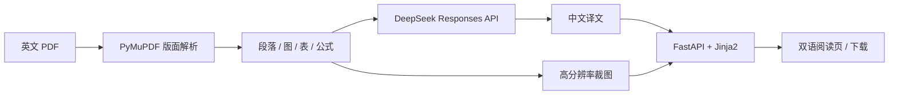

<div align="center">

# Paper 精译 · Literature Translation

**把英文学术 PDF 变成可读的中文双语阅读页**

[](https://www.python.org/)
[](https://fastapi.tiangolo.com/)
[](https://pymupdf.readthedocs.io/)
[](https://www.deepseek.com/)
[](LICENSE)

上传一篇英文 PDF，自动解析版面、逐段翻译，生成宽屏中文阅读页。
**一段英文原文在上，对应的中文译文在下；公式、化学式、图表与表格保持原样。**

</div>

---

## ✨ 项目亮点

| 能力 | 说明 |
| --- | --- |
| 📐 版面感知 | 自动识别双栏论文，按阅读顺序重排为单栏中文阅读流 |
| 🌐 双语对照 | 每段英文原文在上、中文译文在下；阅读栏约 1200px |
| 🧪 公式与化学式 | 公式、化学式、变量、单位不翻译，按原页面区域高清裁图 |
| 📊 图表原样保留 | 图、表整体裁图并居中显示，图注/表注居中排版 |
| 🧠 LLM 翻译 | DeepSeek `deepseek-flash`（Responses API）逐段翻译，JSON Schema 结构化输出 |
| ⚡ 结果缓存 | 按“模型 + 提示词版本 + 类型 + 原文”哈希缓存，重复解析不重复计费 |
| 📥 一键导出 | 下载原文 PDF；下载自包含 HTML 译文（图片已内嵌，可打印为 PDF） |
| 📱 响应式 | 桌面与手机均可阅读；支持双语/仅中文、打印、原文 PDF 浏览器内打开 |
| 🖼️ 图片容错 | 图片加载失败自动重试，阅读页禁用过期缓存，避免旧页面破图 |

> 设计取舍：本项目只使用 DeepSeek 的文本翻译能力，不依赖视觉输入。
> 版面解析、阅读顺序、图表/公式定位由本地 PyMuPDF 完成；
> 翻译、标题/图注文案与段落重组由 DeepSeek 完成。

## 🚀 快速开始

### 1. 创建环境

```bash
conda env create -f environment.yml
conda activate pdf-translator
```

或使用已有环境安装依赖：

```bash
conda activate pdf-translator
python -m pip install -r requirements.txt
```

### 2. 配置 DeepSeek

```bash
cp .env.example .env
```

编辑 `.env`：

```dotenv
DEEPSEEK_API_KEY=sk-your-key-here
DEEPSEEK_BASE_URL=https://api.deepseek.com
DEEPSEEK_MODEL=deepseek-flash
DEEPSEEK_EFFORT=low
```

> `.env` 已被 `.gitignore` 忽略，不会进入 Git 仓库，也不会发送到前端。

### 3. 启动

```bash
python -m uvicorn app.main:app --host 127.0.0.1 --port 8000
```

Windows 也可以双击 `run.bat`。脚本会自动探测 conda 环境；如果 8000 端口已有 Paper 精译在运行，会直接打开浏览器而不是重复启动。

打开 <http://127.0.0.1:8000>。

## 🧭 使用流程

1. 拖入或选择英文 PDF（文本层可提取，建议 20 MB 以内）。
2. 后台解析版面：识别标题、摘要、章节、段落、图表、公式、表注。
3. DeepSeek 分批翻译；页面实时显示进度。
4. 完成后进入阅读页：
   - 英文原文 + 中文译文上下对照
   - 图/表/公式按接近原图尺寸居中展示
   - 支持“双语 / 仅中文”“打印”“原文 PDF”
   - 支持“下载原文”“下载译文”

## 🧠 工作原理



1. **版面解析**：提取文本块、字体、字号、坐标；按页面中缝把双栏切成左右栏，宽块作为水平分带，形成自然阅读顺序。
2. **阅读流重建**：过滤页眉页脚和页码；识别标题、摘要、章节、图注、表注；合并跨栏/跨页断开段落。
3. **图表与公式**：`find_tables()` 定位表格并整块裁图；图片块与图注锚定矢量图；数学字体/符号密度识别公式并聚类裁图。表格内文字不进入翻译流。
4. **翻译**：按 6k 字符 / 12 块分批，3 并发调用 `deepseek-flash`；使用 JSON Schema 强制返回 `{id, translation}`，缺块自动按段重试。
5. **渲染**：服务端 Jinja2 组装约 1200px 阅读栏；英文 14px、中文 18px 衬线正文；图 640px、表 900px、公式 520px 上限，居中显示。
6. **导出**：原文直接下载 PDF；译文导出为自包含 HTML，图表以 base64 内嵌，可直接打印为 PDF。

## 📁 目录结构

```text
.
├─ app/
│  ├─ main.py        FastAPI 路由、视图组装、下载接口
│  ├─ pdf_parser.py  PDF 版面解析、阅读顺序、裁图、标题恢复
│  ├─ pipeline.py    任务流水线、分批翻译、缓存、进度
│  ├─ llm.py         DeepSeek Responses API 客户端
│  ├─ storage.py     文件任务存储
│  └─ config.py      .env 与路径配置
├─ templates/        index / status / reader / download
├─ static/           style.css, home.js, status.js, reader.js
├─ tests/            解析器集成测试
├─ data/             运行时数据（Git 忽略）
├─ environment.yml
├─ requirements.txt
├─ run.bat
├─ .env.example
├─ LICENSE
└─ README.md
```

## 🔌 API 路由

| 方法 | 路径 | 说明 |
| --- | --- | --- |
| `GET` | `/` | 上传页与最近任务 |
| `POST` | `/api/translate` | 上传 PDF，创建翻译任务 |
| `GET` | `/api/jobs/{job_id}` | 查询任务状态与进度 |
| `GET` | `/doc/{job_id}` | 双语阅读页 |
| `GET` | `/source/{job_id}` | 原文 PDF（浏览器内打开） |
| `GET` | `/download/source/{job_id}` | 下载原文 PDF |
| `GET` | `/download/translation/{job_id}` | 下载自包含 HTML 译文 |
| `GET` | `/media/{job_id}/{filename}` | 图表/公式裁图 |
| `GET` | `/api/health` | 健康检查 |

## ⚙️ 配置项

| 变量 | 默认值 | 说明 |
| --- | --- | --- |
| `DEEPSEEK_API_KEY` | — | DeepSeek API Key |
| `DEEPSEEK_BASE_URL` | `https://api.deepseek.com` | API 地址 |
| `DEEPSEEK_MODEL` | `deepseek-flash` | 模型名称 |
| `DEEPSEEK_EFFORT` | `low` | 思考强度：`none/low/high/max` |
| `BATCH_MAX_CHARS` | `6000` | 单批最大字符数 |
| `BATCH_MAX_BLOCKS` | `12` | 单批最大段落数 |
| `TRANSLATE_CONCURRENCY` | `3` | 并发批次数 |
| `MAX_UPLOAD_MB` | `80` | 上传大小限制 |

## 🧪 测试

```bash
conda activate pdf-translator
python -m unittest discover -s tests -v
```

测试覆盖：标题/摘要/章节/图表/公式/参考文献分类、裁图文件存在、跨栏段落合并、章节标题无残留。

> 集成测试需要一个本地 PDF：`jp309203k.pdf`。
> **该测试论文受版权保护，不随仓库分发**；缺失时测试会自动跳过。你可以放入任意 ACS 风格的双栏论文并命名为该文件。

## ⚠️ 已知限制

- **扫描版 PDF**（纯图片、无文本层）无法解析，需要先 OCR。
- 表格不做重排，按原页面区域裁图；超宽表格在窄屏上可横向滚动。
- 公式和化学式以裁图保留，因此不可选中/搜索；正文中的行内公式由 LLM 原样保留。
- 跨栏/跨页续接采用标点与大小写启发式，极少数段落可能仍分开。
- 阅读页不展示目录、作者信息、致谢、参考文献等页尾栏目。
- “下载译文”是自包含 HTML，不是直接生成的 PDF；可用浏览器“打印 → 另存为 PDF”。
- LLM 按批翻译，跨段术语不保证完全一致；重要论文建议人工校对。
- DeepSeek API 费用由 Key 所属账户承担。

## 🔐 安全与隐私

- `.env`、`data/`、`.reasonix/` 和测试 PDF 均在 `.gitignore` 中。
- API Key 只保存在本机 `.env`，不会进入前端页面或任务 JSON。
- 上传文件、裁图、译文和缓存只保存在本机 `data/` 目录。
- 删除 `data/` 即可清空所有任务和翻译缓存。

## 📄 License

[MIT](LICENSE) © 2026 lyy

## 🙏 Acknowledgements

- [DeepSeek](https://www.deepseek.com/) — 翻译与文本重组
- [PyMuPDF](https://pymupdf.readthedocs.io/) — PDF 解析与页面裁图
- [FastAPI](https://fastapi.tiangolo.com/) / [Jinja2](https://jinja.palletsprojects.com/) — Web 服务与模板
